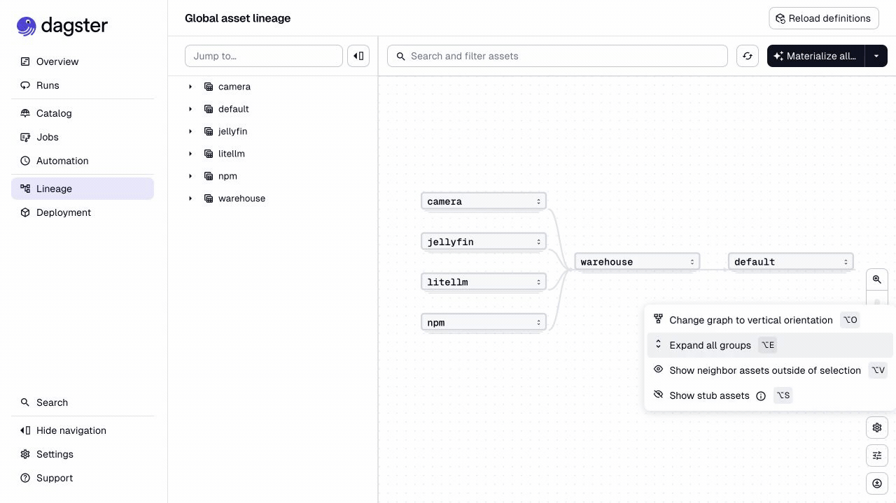
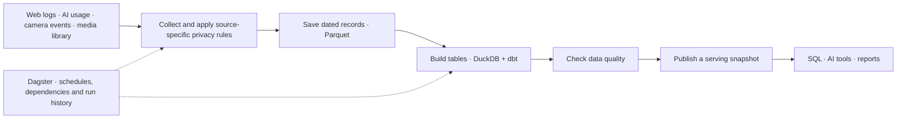
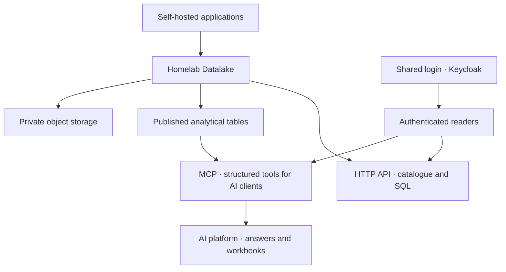

# Homelab Datalake

Homelab Datalake is where I bring together the records my self-hosted applications
produce. It keeps a history of web traffic, AI usage, camera activity, and my
media library, then turns that history into tables I can ask questions about.

I built it to understand what my homelab is doing over time: which applications
use the most AI, when camera activity changes, and how my film library grows.
Dagster runs the work and shows which steps succeeded, failed, or need a retry.

This repository shares the pipeline code, data models, and tests. It uses example
configuration and synthetic fixtures. My live data and deployment configuration
remain private. All 93 original commits are retained individually, with private
references sanitized in each commit.

## A look at the project



This is a screen recording of the running app with synthetic web traffic. It
shows the dependencies, launching a job, its execution and successful finish,
then browsing lake folders, a published table, its SQL, and passing checks.
Pauses are shortened. [Watch the MP4](demo.mp4) or
[follow the recording](docs/WALKTHROUGH.md).

## What I use it for

- **Understanding web traffic:** which applications get requests, when errors
  increase, and how traffic changes from one day to the next.
- **Following AI usage:** comparing models and workloads by cost, token use,
  and response time.
- **Keeping camera history:** analysing events, crossings, state changes, and
  periods when the camera was actually observing an area.
- **Following the media library:** comparing snapshots of titles, genres, and
  technical metadata without copying the films.
- **Building reports:** querying the same published tables from SQL or AI tools,
  then exporting a workbook that records where the answer came from.

## How records become useful answers

The collectors read each application's records. The pipeline parses them,
checks their shape, and saves them by date. It then builds cleaned tables and
summaries, checks the results, and publishes a database for readers.



Dagster tracks each transformation as an asset. That makes a failed step visible
in the context of the tables that depend on it. A date partition lets me retry
one day's collection without reloading the entire history.

The stored data has three layers: **raw** records after source-specific
filtering, **curated** tables with consistent types, and **marts**, which are
facts and summaries prepared for analysis.

## What data is in it

| Source | Records collected | An example question |
| --- | --- | --- |
| Nginx Proxy Manager | Requests, response codes, paths, and pseudonymous visitor identifiers | Which application had the most errors? |
| LiteLLM | Model calls, costs, token counts, timing, and workload metadata | Where did AI spending go? |
| Homelab Camera | Events, clip metadata, zone states, annotations, and observation coverage | When was activity highest, and was the camera observing then? |
| Jellyfin | The whole library -- movies, series, seasons, episodes, box sets and other videos -- with playback sessions, the activity log, and accounts | Who watched what, and how has the library changed? |
| TMDB and MaxMind, optional | Film information and coarse geographic/network context | How do titles or traffic compare by region? |

Camera recordings stay in the camera application, and media files stay in
Jellyfin. This public repository contains no production records or actual
usage totals. The local walkthrough generates web logs; the other collectors
are exercised by synthetic unit-test fixtures.

## How it fits into my homelab

The datalake reads from the applications without taking over their jobs. MinIO
stores the dated files. A shared identity service controls access to the live
interfaces. My AI platform uses the published tables to answer questions and
produce reports.



The live Dagster workspace also hosts a separate code location for my AI
platform's automation jobs. Those jobs belong to another project. The public
example loads only the datalake.

## Keeping the history trustworthy

Camera analysis can arrive after the event. The collector revisits recent days
and merges by identity, preserving previously collected events when a later
export contains fewer rows. Observation coverage helps distinguish a quiet
period from a period with no camera observations.

Readers use a separate DuckDB serving file. A successful build replaces that
snapshot; a failed build leaves the previous one available. Results can therefore
be stale after a failure, and their freshness matters.

Checks cover duplicate events, date alignment, spending totals, library history,
privacy rules, and the separation between build tables and published tables.
These choices make the project useful beyond a dashboard: it is a repeatable
path from application records to an answer I can inspect.

## Privacy and access

Web-log ingestion removes the raw client address and query-string values. A
keyed pseudonym supports visitor counts without storing that address in its
place. Camera ingestion excludes footage and zone geometry; library ingestion
excludes media file paths.

Filtering differs by source. The LiteLLM collector can retain request/response
payloads, requester addresses, and metadata when the upstream ledger contains
them. Raw and curated tables must remain private. Pseudonyms and coarse networks
are not a guarantee of anonymity.

The live interfaces use bearer tokens and roles. MCP provides validated,
read-only analytical tools. The SQL API has broader access and a separate,
disabled-by-default write setting. The [sharing notes](docs/PUBLIC_RELEASE.md)
explain what was removed for this release.

## What it is built with

Python implements the collectors and interfaces. **Dagster** schedules work and
tracks dependencies. **Parquet and MinIO** store records, **DuckDB** queries them,
and **dbt** defines and tests the analytical tables. **Keycloak** handles identity;
**MCP and an HTTP API** make the results available to other tools.

To inspect the implementation, start with [the Dagster definitions](src/homelab_datalake/definitions.py),
[the SQL models](dbt/models), and [the tests](tests).

## Try it with synthetic data

Use Python 3.12 and run these commands from the repository root. Installation and
the initial dbt package download require internet access; the generated pipeline
does not need homelab credentials or services.

```sh
python3.12 -m venv .venv
. .venv/bin/activate
pip install -e '.[dev]'
bash scripts/demo.sh
```

The script uses an isolated `.demo/` directory, generates three days of example
web logs, runs all six date/host partitions, checks a repeat run, and builds the
published tables. It also saves a short traffic summary locally.

To explore the asset graph and run history afterward:

```sh
. scripts/demo-env.sh
dagster dev -h 127.0.0.1 -p 3000
```

Open `http://127.0.0.1:3000`. Source schedules are stopped by default. The demo
has synthetic web traffic; it does not simulate a connected camera or media
server. Run `ruff check src scripts tests` and `pytest -q` for the code checks.
