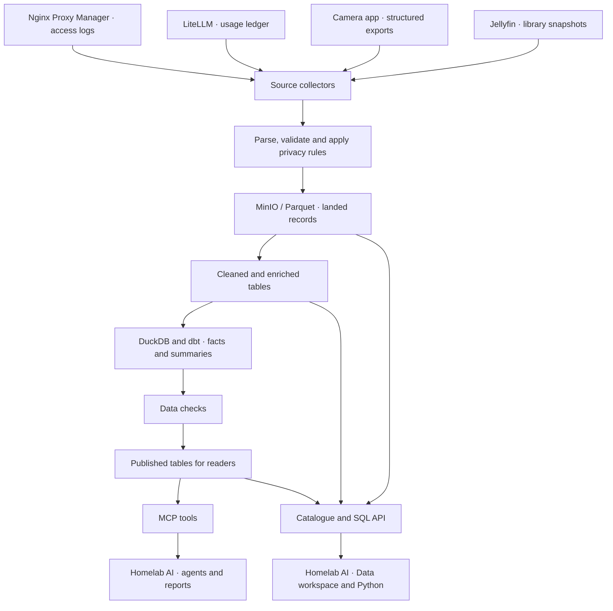
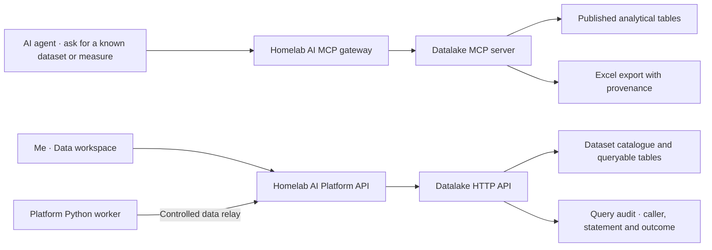
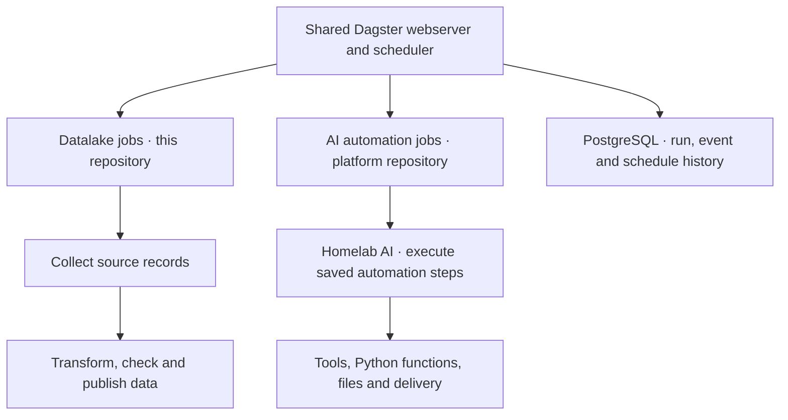

# Homelab Datalake

This is where I bring together the data my homelab applications produce. It
keeps a longer history of web traffic, AI usage, camera activity, and my media
library, then turns those records into tables I can query and compare.

I use it to answer questions such as “Which applications used the most AI this
month?”, “When was the gate busiest?”, or “How has my film library changed?”
The source applications keep doing their own jobs. The datalake collects their
records and gives me a consistent place to work with them.

Homelab AI can read this data through MCP tools or its Data workspace. Dagster,
which runs the data pipelines, also hosts the AI platform's automation jobs.

## What comes into it

| Source | What is collected | What I can learn from it |
| --- | --- | --- |
| Nginx Proxy Manager | Requests from the mounted reverse-proxy logs. | Traffic by application, response status, visitors, and patterns over time. |
| LiteLLM | Model-call and spend records. | Which models and callers consume tokens, what requests cost, and how long they take. |
| Homelab Camera | Structured camera events, analysis, and related activity records from its export API. | Camera activity, passage counts, state changes, and observation coverage. |
| Jellyfin | Library snapshots and the metadata attached to titles. | What is in the library and how its composition changes. |
| TMDB and MaxMind, when configured | Additional film metadata and network/geographic enrichment. | Extra context for media and traffic analysis. |

The datalake works with records and metadata. Camera recordings stay with the
camera application, and media files stay with Jellyfin.

## How the data moves

The stored data has three layers:

- **Raw** keeps the records as they arrive after the required privacy filtering.
- **Curated** holds cleaned, typed, and enriched data that can be reused.
- **Marts** are tables prepared for questions: facts and totals about traffic,
  model usage, camera activity, and the media library.

Parquet files in MinIO hold the data. DuckDB queries and combines it. dbt defines
the transformations and checks the resulting tables. Dagster knows which steps
depend on which others and runs the collection and publishing jobs.

## Asking questions through Homelab AI

There are two interfaces because asking for a known measure and writing an
analysis are different kinds of work.

### MCP tools

The MCP server offers datasets in a shared vocabulary: web traffic, model
spend, camera activity, and the media library. A caller chooses dimensions,
measures, filters, and a time range. The server validates those choices and
builds the query.

For example, an agent can group model spending by day and model without
inventing table names or deciding how cost should be aggregated. It can also
discover datasets, read their descriptions, and export an Excel workbook with
information about where the result came from. This interface is read-only and
does not accept arbitrary SQL.

### Data workspace and Python

The HTTP API supplies the catalogue and SQL queries used by the platform's
Data workspace. It lets me inspect the underlying tables and write an analysis
that goes beyond the predefined MCP questions.

Python in the AI platform reaches that API through a controlled relay. The
relay sends read-only queries with user attribution. The datalake's separate
SQL API also has an explicit writable mode, gated by deployment settings;
statement checks and audit records
belong to the datalake rather than being reimplemented in each client.

## Keeping history useful

The source collectors run on schedules, followed by a job that builds and
checks the analytical tables and publishes the results. Most collection is
organised by day, which makes it possible to retry or rebuild a particular
period.

Camera data needs extra care because clip analysis can arrive after the event,
and older records eventually disappear from the camera app's own store. The
collector revisits recent periods and merges records by event identity. It
keeps previously collected events when a later export returns fewer rows, and
updates them when newer information is available.

The model-facing tables are published as a separate DuckDB serving copy.
Readers keep using the last successfully published snapshot while a new build
runs. A failed build leaves that previous snapshot available, so a query can
return older data without reading half of a rebuild. Data freshness therefore
matters alongside the result itself.

## Sharing Dagster with the AI platform

The datalake jobs and AI automation jobs are separate code locations in the
same Dagster workspace. The first builds the warehouse. The second loads the
platform's saved automations and calls back into the platform to execute their
steps. This gives both kinds of recurring work a shared place to inspect runs
and failures, while their application logic stays in their own projects.

## Privacy and access

Traffic ingestion removes raw client addresses before writing data to the lake.
It keeps a keyed pseudonym, a coarse network, and a label indicating whether
the address represented a visitor or a CDN edge. Geographic enrichment, when
available, happens before the original address is discarded. This reduces the
identifying information retained while keeping traffic analysis useful.

Camera exports omit footage and zone geometry and pseudonymise creator
identity. The datalake preserves the structured records it needs for analysis.
Real datasets, credentials, and generated exports remain private.

People reach the Dagster interface through Keycloak login. Programmatic callers
use Keycloak bearer tokens with the datalake query role. The platform passes
user attribution with its service requests, and the SQL API records queries
and refusals in its audit log.

## The main parts of the project

| Part | Responsibility |
| --- | --- |
| Source collectors | Read application exports, logs, and usage records, organised into time partitions. |
| MinIO and Parquet | Keep landed records, cleaned data, and published results. |
| DuckDB | Query files and build the analytical warehouse. |
| dbt | Define the transformations, table descriptions, and data checks. |
| MCP server | Expose validated analytical questions and workbook exports to AI clients. |
| HTTP API | Provide the catalogue, SQL access, and query audit used by the Data workspace. |
| Dagster | Run pipelines and automations, track their dependencies, and retain execution history. |

The datalake is the shared history behind these applications. It lets a question
start in an AI conversation, continue as a SQL or Python analysis, and end in a
report built from the same underlying records.
